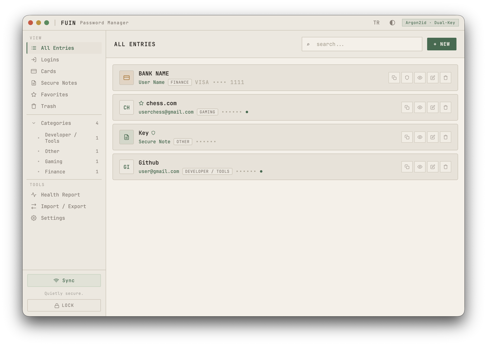
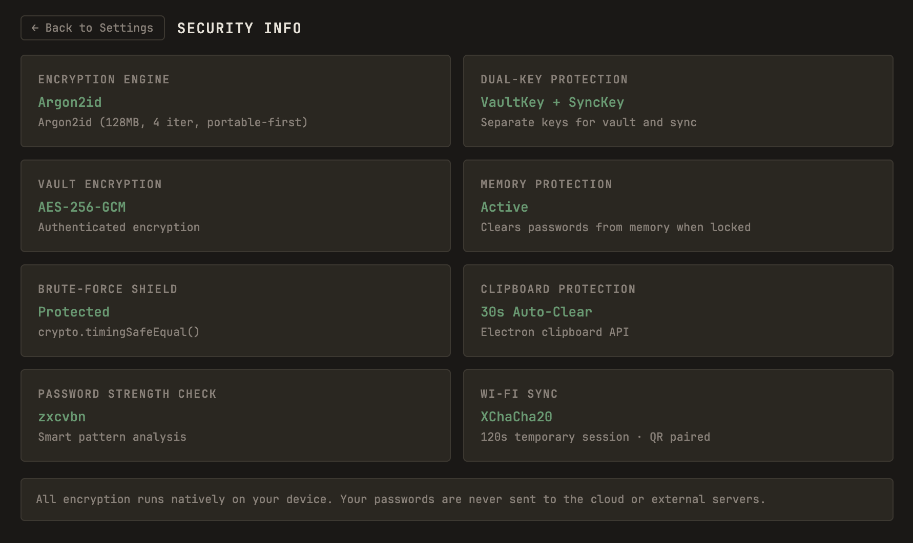
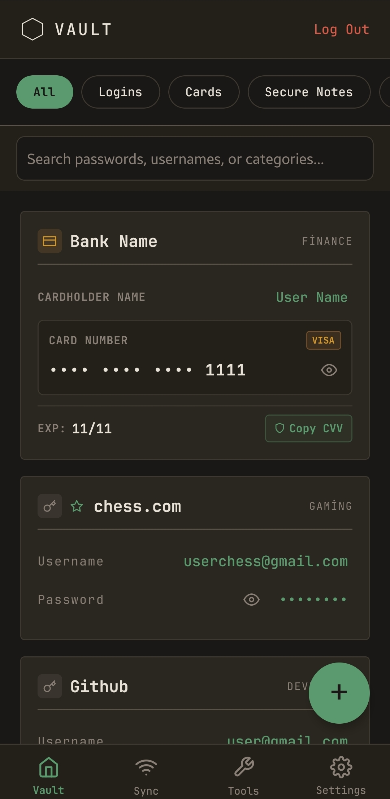

<div align="center">


# Fuin
**Quietly secure.**

An offline-first password, card, and 2FA manager I built for my own devices—with no accounts, no telemetry, and no cloud servers.

[](https://www.gnu.org/licenses/agpl-3.0)
[](#)
[](#browser-extensions-chrome--firefox)
[](https://github.com/Sombooo/FuinMobile)

</div>

<br />

## An Honest Note Before You Start

I built **Fuin** with the help of **AI coding tools** because I wanted a calm, private place to keep my logins and 2FA codes on my own hardware instead of paying for—or trusting—cloud servers.

I'm a solo builder, not a big security vendor. I've put a lot of care into testing and hardening the app, and I use it myself every day, **but** no software is bug-free and Fuin hasn't been through an external third-party audit yet. Also, because Apple and Windows code-signing certificates are expensive, the prebuilt installers aren't officially signed for now—so your OS may show an "unrecognized developer" warning unless you build from source.

If you decide to try it out, inspect the code, or break something and report it, I genuinely appreciate it.

<br />

<table>
  <tr>
    <td align="center" width="50%">
      
      <sub><b>Lock Screen (Zen Dark)</b></sub>
    </td>
    <td align="center" width="50%">
      
      <sub><b>Vault — Logins, Cards & Secure Notes</b></sub>
    </td>
  </tr>
  <tr>
    <td align="center" width="50%">
      
      <sub><b>Warm Paper Theme</b></sub>
    </td>
    <td align="center" width="50%">
      
      <sub><b>Under the Hood — Security Overview</b></sub>
    </td>
  </tr>
</table>

<br />

## Why I Built Fuin

Honestly, I just got tired of trusting remote servers with every account I own. At the end of the day, a password vault is just an encrypted file—I wanted mine to stay on my own computer and phone, without logins, subscriptions, or background network traffic.

So I built Fuin around one simple idea: **everything stays local by default.** When I need my passwords on my phone, I pair it once with a QR code and sync directly over my own Wi-Fi or hotspot.

---

## What It Does

- **Logins, Payment Cards & Secure Notes:** Store website credentials, cards (with formatting and brand recognition), and private notes in one calm interface.
- **Direct Phone Sync (No Cloud):** Pair **[Fuin Mobile](https://github.com/Sombooo/FuinMobile)** once via QR code. When you tap sync, Desktop opens a temporary local listener for up to 120 seconds over your home Wi-Fi or hotspot, merges edits both ways without losing password history, and closes the port right after.
- **Built-in 2FA (TOTP):** Keep your TOTP secrets right next to your logins and copy 6-digit codes whenever you need them.
- **Recovery Key & Master Password Change:** Generate an emergency recovery key so you can reset access locally if you forget your master password, or rotate your master password cleanly from Settings.
- **Password Generator & Health Check:** Generate strong passwords offline, check weak or reused passwords locally, and optionally run a k-Anonymity breach check via HaveIBeenPwned (only the first 5 characters of a SHA-1 hash leave your machine).
- **Backups & Easy Migration:** Import from **Bitwarden (JSON)**, **1Password (CSV)**, **LastPass (CSV)**, or **Chrome / Edge (CSV)**, or export portable encrypted `.fuin` backups and automatic local `.bak` snapshots.
- **Themes, Languages & Touch ID:** Includes **Zen Dark** and **Warm Paper**, Turkish & English language support, and **Touch ID** unlock on macOS.

---

## Browser Extensions (Chrome & Firefox)

Both the **Chrome / Chromium** (Chrome, Brave, Edge) and **Firefox** companion extensions are ready to use—you can grab them from their extension stores or load the [`./browser-extension`](./browser-extension) folder directly from source if you prefer inspecting what runs in your browser.

I tried to keep the extensions simple and cautious:
- **Local Desktop Bridge Only:** The extension talks solely to the Fuin Desktop app on your computer through native OS messaging. It never makes external network requests.
- **No Silent Background Filling:** It waits for your click, keyboard shortcut (`Ctrl+Shift+L` / `Cmd+Shift+L`), or popup choice rather than quietly injecting credentials into random forms on page load.
- **Save Prompt & Domain Checks:** When you sign in on a site, it offers to save or update the entry cleanly—and keeps shared platforms (like `github.io`, `wordpress.com`, `vercel.app`, etc.) isolated by exact subdomain.

*(See [`browser-extension/README.md`](./browser-extension/README.md) if you'd like step-by-step setup instructions for Developer Mode or manual native host wiring.)*

---

## Fuin Mobile (Android)

I also built **[Fuin Mobile](https://github.com/Sombooo/FuinMobile)** for Android so I could carry the same offline vault in my pocket, use native Android Autofill, scan `otpauth://` QR codes, and sync directly with Desktop over local Wi-Fi.

<div align="center">
<table>
  <tr>
    <td align="center" width="33%">
      <br />
      <sub><b>Lock Screen</b></sub>
    </td>
    <td align="center" width="33%">
      <br />
      <sub><b>Mobile Vault (Zen Dark)</b></sub>
    </td>
    <td align="center" width="33%">
      <br />
      <sub><b>Warm Paper Theme</b></sub>
    </td>
  </tr>
</table>
</div>

---

## What I'm Planning Next

Still in beta, I'm taking things one step at a time. Some features on my list for later updates:
- **Passkeys (WebAuthn)** support
- **KeePass (`.kdbx`)**, **1Password (`.1pux`)**, and **Apple Passwords** importers
- **Encrypted file attachments** & **custom fields**
- **Folders / tags** for organizing larger vaults

---

## Support & Feedback

Fuin is free, open-source software under **AGPLv3**. If you try it out and hit a bug, notice a UX rough edge, or spot something that can be safer, feel free to open an issue or PR. And if it ends up being useful to you and you'd like to buy me a coffee, you can do that below.

Wishing you all happy days — and don't forget to drink some water and stay hydrated!

[](https://fuindev.lemonsqueezy.com/checkout/buy/c898c753-098b-4c0b-a721-77332db06bdc)

---

## Technical Details & Source Build

For developers or anyone who wants to inspect how Fuin handles keys, sync packets, and local isolation under the hood:

### Security Design (Plainly Summarized)
No software can promise to be unbreakable, and local software ultimately relies on the health of the OS it runs on. Within those real-world limits, here is what I implemented:

- **Key Derivation:** Master passwords derive encryption keys via **Argon2id** (`128 MiB` memory cost, `4` iterations on Desktop; `64 MiB`, `3` iterations on Mobile), slowing down offline brute-force attempts.
- **Vault Encryption:** Local vaults (`fuin.enc`) and `.fuin` exports use **AES-256-GCM** with fresh CSPRNG nonces and salts on every write, plus atomic file replacement with `.bak` recovery snapshots.
- **In-Memory & OS Hygiene:** Sensitive key buffers in Electron's main process use `sodium_mlock` and `Buffer.fill(0)`, renderer secrets are held encrypted under an ephemeral WebCrypto key while unlocked, copied secrets auto-clear from the clipboard after 30 seconds, and Electron `BrowserWindow` runs with `sandbox: true`, `contextIsolation: true`, `nodeIntegration: false`, strict CSP headers, and `setContentProtection(true)` in production.
- **Local Extension Bridge Isolation:** The local UNIX socket / Windows named pipe and auth token (`fuin.ext-token`) enforce owner-only permissions (`0o700` / `0o600`), symlink checks (`lstatSync`), HMAC message auth, and per-socket failure throttling.
- **LAN P2P Sync Transport:** Sync sessions use an ephemeral HTTP listener capped at 120 seconds, accept only local private IPv4/IPv6 peers (`RFC1918` / link-local), block browser `Origin` headers, and encrypt payloads end-to-end with **XChaCha20-Poly1305** and nonces to guard against replay and reflection.

More details are documented in [`SECURITY.md`](./SECURITY.md), [`PRIVACY.md`](./PRIVACY.md), and [`docs/SECURITY_MODEL.md`](./docs/SECURITY_MODEL.md).

### Running & Building from Source

```bash
# Install dependencies
npm install

# Run static checks and test suites
npm test

# Start the app in development mode
npm start

# Package installers for macOS (.dmg) or Windows (.exe)
npm run build-mac
npm run build-win
```
