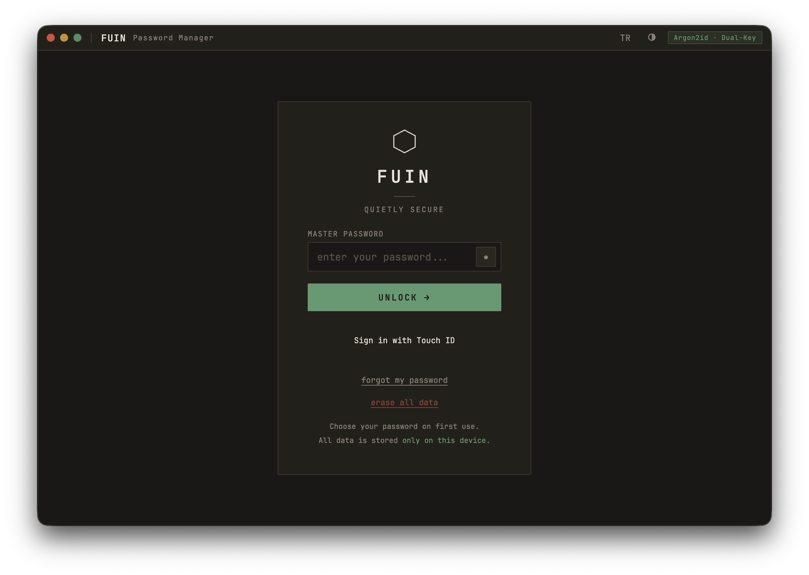
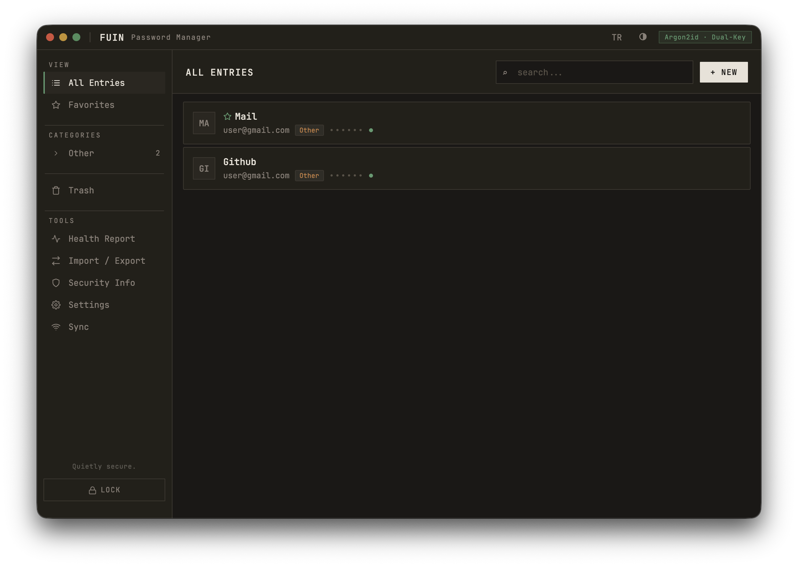
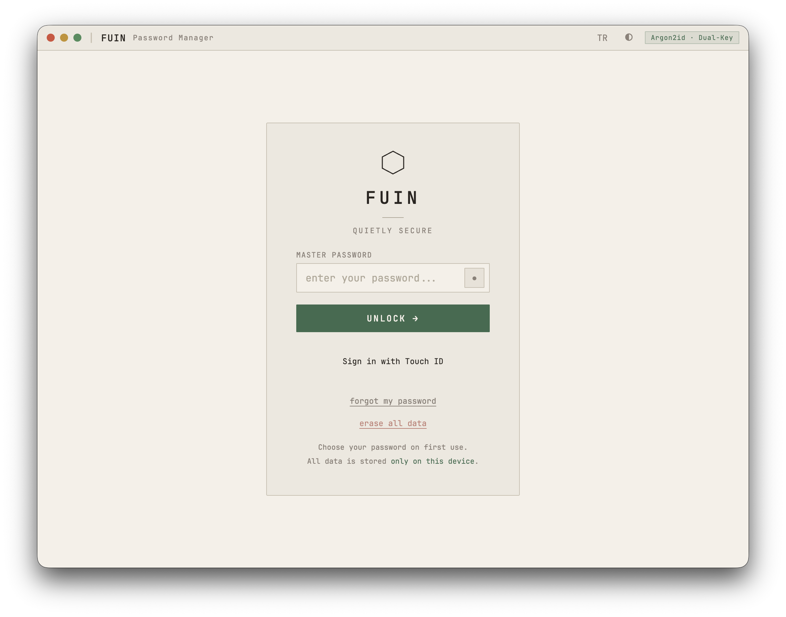
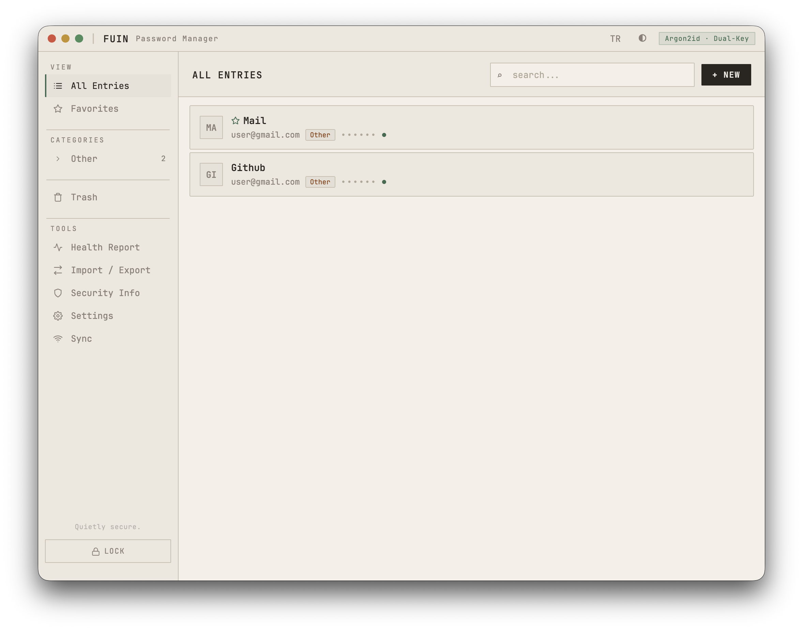
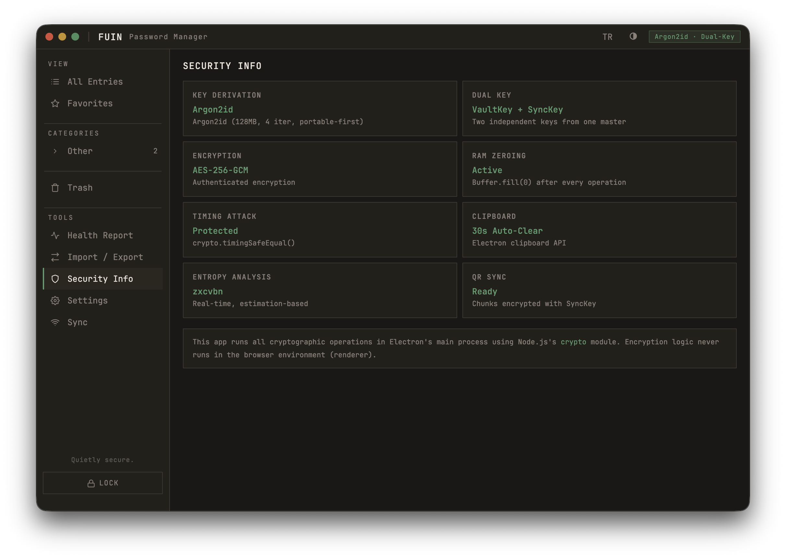
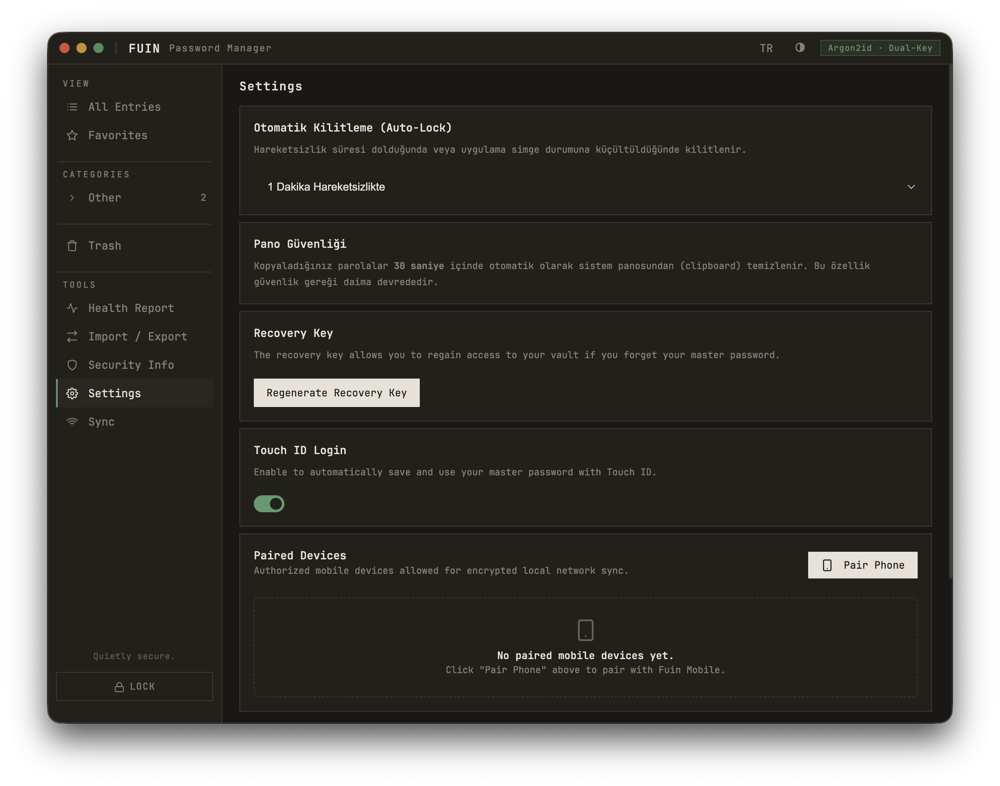
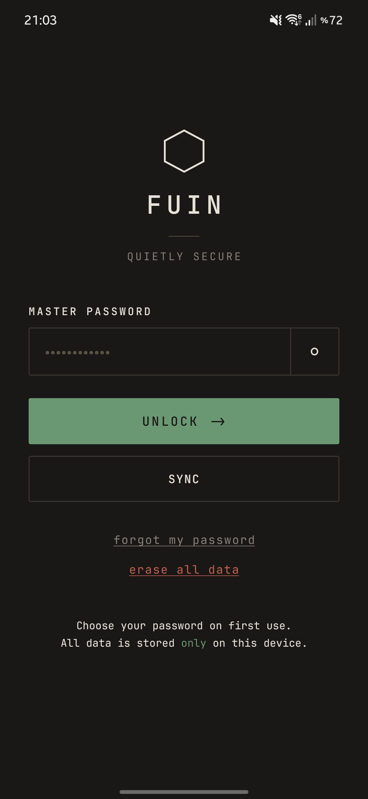
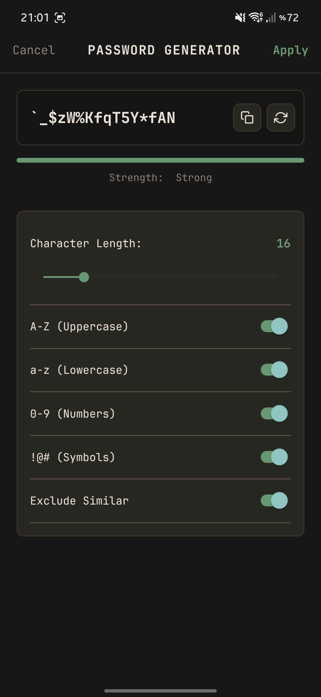

<div align="center">


# Fuin
**Quietly secure.**

A calm, local-first password and 2FA manager I built for Desktop and Mobile.

[](https://www.gnu.org/licenses/gpl-3.0)
[](#)
[](https://github.com/Sombooo/FuinMobile)

</div>

<br />

<table>
  <tr>
    <td align="center" width="50%">
      
      <sub><b>Zen Dark — Lock Screen</b></sub>
    </td>
    <td align="center" width="50%">
      
      <sub><b>Zen Dark — Vault View</b></sub>
    </td>
  </tr>
  <tr>
    <td align="center" width="50%">
      
      <sub><b>Warm Paper — Lock Screen</b></sub>
    </td>
    <td align="center" width="50%">
      
      <sub><b>Warm Paper — Vault View</b></sub>
    </td>
  </tr>
</table>

<br />

## Why I Built Fuin

I wanted a password manager that feels calm, stays out of the way, and doesn't require trusting a remote cloud server with all of my logins. Most password managers today ask you to create an account, pay a recurring subscription, and keep your vault synced to their infrastructure.

I built **Fuin** around a simpler idea: **your passwords should just live on your own devices.** There are no accounts to sign up for, no background telemetry, and no cloud servers in the middle. It is a personal, open-source project designed with care for people who prefer owning their own data.

---

## ✨ What It Does

- **Local Vault:** Your data is encrypted and stored directly on your computer's disk.
- **Two Ways to Sync with Your Phone:**
  - **Local Wi-Fi Sync (LAN):** Pair your phone once by scanning a QR code. When you hit sync, Fuin opens a temporary 120-second encrypted local connection over your home Wi-Fi, merges changes both ways without losing history, and closes the port immediately.
  - **Air-Gap QR Sync:** If you don't even want to use Wi-Fi, you can transfer your encrypted vault optically from screen to camera using animated QR codes.
- **Built-in 2FA (TOTP) Codes:** You can store your 2FA secret keys right inside your entries and generate 6-digit time-based codes without needing a separate authenticator app.
- **Password Generator & Health Check:** Includes an offline password strength analyzer (`zxcvbn`), duplicate/weak password detection, and an optional breach check using the HaveIBeenPwned k-Anonymity API (only the first 5 characters of the SHA-1 hash ever leave your device).
- **Easy Import & Export:** Supports importing existing passwords from **Bitwarden (JSON)**, **1Password (CSV)**, **LastPass (CSV)**, and **Chrome / Edge (CSV)**, plus encrypted `.bak` automatic backups.
- **Warm Paper & Zen Dark Themes:** Designed to feel like a quiet notebook rather than a cluttered dashboard.

<table>
  <tr>
    <td align="center" width="50%">
      
      <sub><b>Under the Hood — Security Overview</b></sub>
    </td>
    <td align="center" width="50%">
      
      <sub><b>Settings, Touch ID & Device Pairing</b></sub>
    </td>
  </tr>
</table>

---

## 📱 Fuin Mobile Companion

I also built **[Fuin Mobile](https://github.com/Sombooo/FuinMobile)** so I could carry my vault on my phone and sync it locally with the desktop app.

<div align="center">
<table>
  <tr>
    <td align="center" width="33%">
      <br />
      <sub><b>Mobile Lock Screen</b></sub>
    </td>
    <td align="center" width="33%">
      <br />
      <sub><b>Warm Paper Vault</b></sub>
    </td>
    <td align="center" width="33%">
      <br />
      <sub><b>Password Generator</b></sub>
    </td>
  </tr>
</table>
</div>

---

## 🧩 Browser Extension

Fuin comes with a lightweight browser extension to help fill logins on websites while keeping the desktop app in control.

### Setup (Chrome, Brave & Edge)
1. Open your browser's extension page (`chrome://extensions` or `edge://extensions`).
2. Turn on **Developer Mode** in the top-right corner.
3. Click **Load unpacked** and select the [`browser-extension`](./browser-extension) folder from this repo.
4. While the Fuin desktop app is unlocked, the extension communicates with it locally over native OS messaging and asks for your approval before filling credentials.

---

## 🔐 How Security Works (No Buzzwords)

No software can promise "100% unbreakable" security, so instead of marketing claims, here is transparently how Fuin handles your data:

- **Key Derivation (`Argon2id`):** Your master password is turned into encryption keys using **Argon2id** (`128 MiB` memory cost, `4` iterations), making brute-force guessing slow and expensive.
- **Vault Encryption (`AES-256-GCM`):** Your local vault file and automatic backups are encrypted with authenticated **AES-256-GCM**. If the file is tampered with, decryption fails safely.
- **Dual-Key Separation:** Your master password derives two separate keys—one for your local disk vault (`VaultKey`) and one for sync (`SyncKey`).
- **LAN & QR Encryption (`XChaCha20-Poly1305`):** Local sync packets are encrypted end-to-end with **XChaCha20-Poly1305** and verified with nonces so old packets cannot be replayed.
- **Memory & Clipboard Hygiene:** Sensitive buffers are zeroed out (`Buffer.fill(0)`) after operations, screenshots are blocked in production builds, and copied passwords are automatically cleared from your clipboard after 30 seconds.

If you'd like to inspect the technical details or threat model, feel free to check [`SECURITY.md`](./SECURITY.md).

---

## 🛠️ Running from Source

If you want to run or build Fuin yourself:

```bash
# Install dependencies
npm install

# Run syntax & security test suites
npm test

# Start the app in development mode
npm start

# Build installers for macOS (.dmg) or Windows (.exe)
npm run build-mac
npm run build-win
```

---

## ☕ Support

Fuin is an independent open-source project licensed under the **GPLv3**. If you find it useful and want to support my work on it, you can buy me a coffee below—thank you!

[](https://fuindev.lemonsqueezy.com/checkout/buy/c898c753-098b-4c0b-a721-77332db06bdc)
