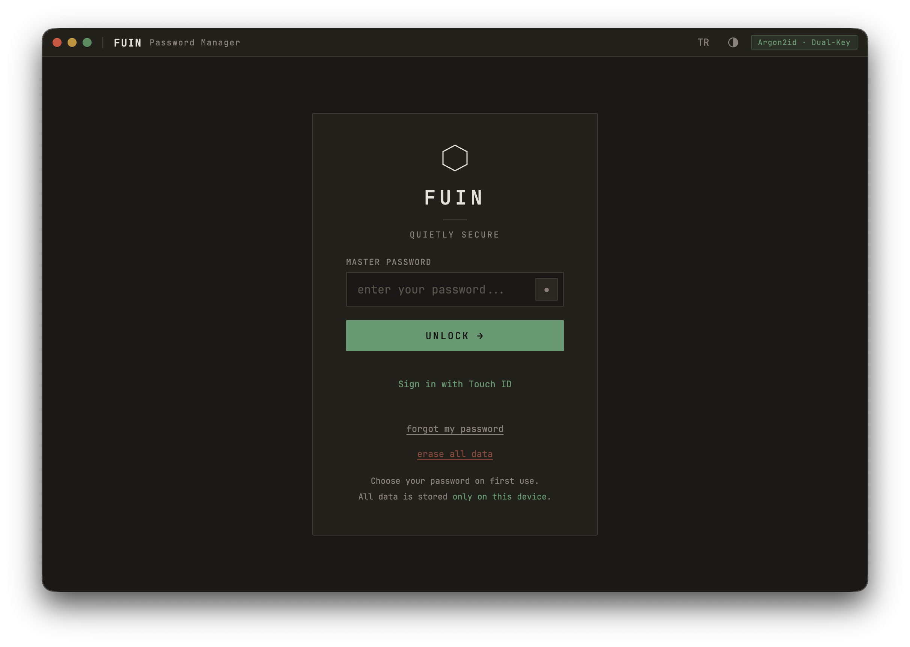
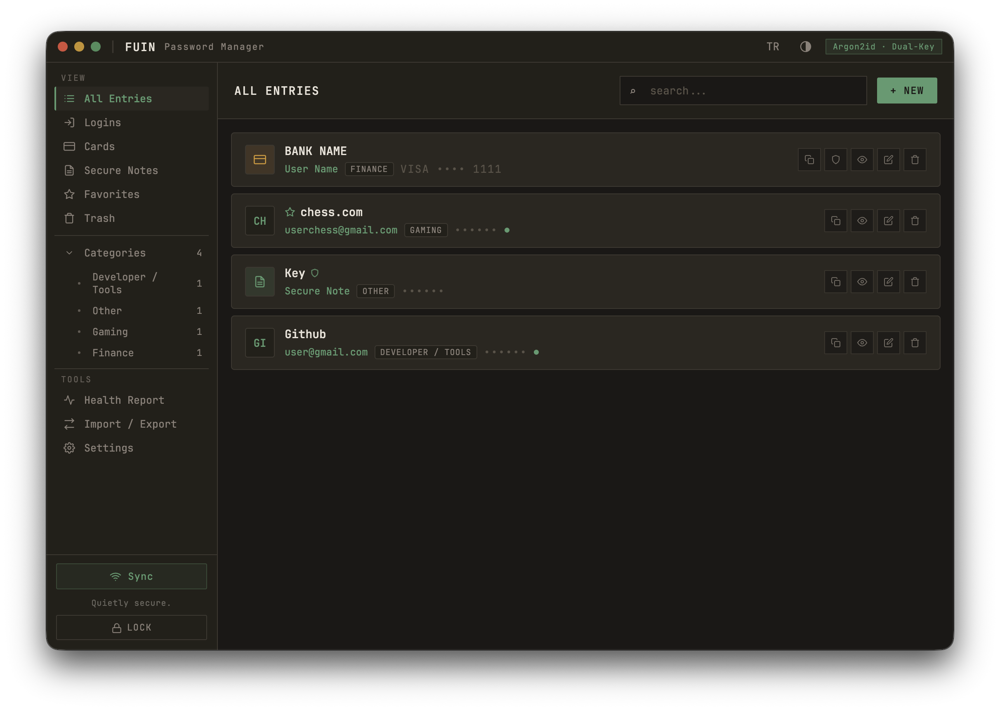
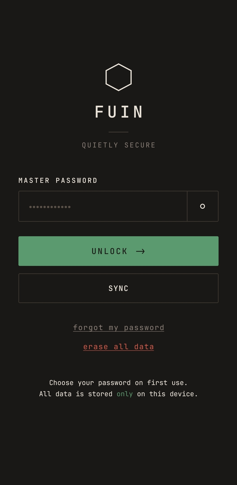
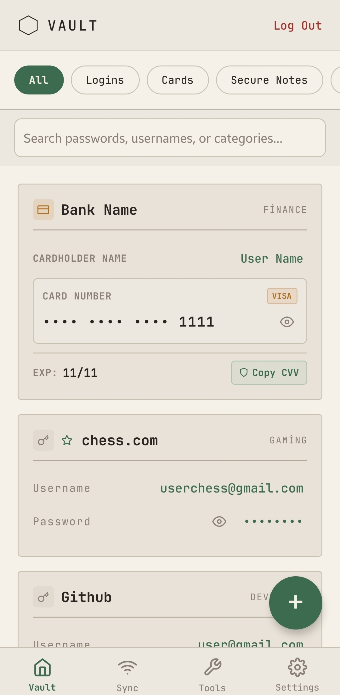

<div align="center">


# Fuin
**Quietly secure.**

A local-first password, card, and 2FA manager I built because I wanted my credentials to live on my own devices.

[](https://www.gnu.org/licenses/agpl-3.0)
[](#)
[](https://github.com/Sombooo/FuinMobile)

</div>

<br />

<table>
  <tr>
    <td align="center" width="50%">
      
      <sub><b>Lock Screen (Zen Dark)</b></sub>
    </td>
    <td align="center" width="50%">
      
      <sub><b>Vault — Logins, Cards & Secure Notes</b></sub>
    </td>
  </tr>
  <tr>
    <td align="center" width="50%">
      
      <sub><b>Warm Paper Theme</b></sub>
    </td>
    <td align="center" width="50%">
      
      <sub><b>Under the Hood — Security Overview</b></sub>
    </td>
  </tr>
</table>

<br />

## Why I Built Fuin

Honestly, I just got tired of trusting remote cloud servers with everything I log into—or paying a subscription for what is basically an encrypted file on my own machine. I wanted a calm, keyboard-friendly app that stays out of the way, works completely offline by default, and lets anyone inspect how the cryptography actually works.

So I built **Fuin** around a simple rule: **no accounts, no telemetry, and no cloud server in the middle.** Your vault stays encrypted on your computer's disk. When I need my passwords on my phone, I pair it once and sync directly over my own Wi-Fi.

This is a solo, open-source beta project that I use every day myself and keep polishing as I go.

---

## What It Actually Does

- **Logins, Cards & Secure Notes:** Keep website passwords, payment cards (with card brand detection and formatting), and encrypted private notes in one place.
- **Direct Phone Sync (Zero Cloud):** Pair your phone once via a one-time QR code. Whenever you hit sync, Fuin opens a temporary 120-second encrypted connection over your local Wi-Fi or phone hotspot, merges changes two-way without dropping password history, and shuts the port right down.
- **Built-in 2FA (TOTP):** Save your 2FA secret keys alongside your logins and grab 6-digit verification codes without reaching for another app.
- **Password Generator & Health Check:** Generate strong passwords offline, spot weak or reused entries locally using `zxcvbn`, and optionally check against known breaches via HaveIBeenPwned's k-Anonymity API (only the first 5 characters of a SHA-1 hash ever leave your machine).
- **Easy In & Encrypted Backups:** Import from **Bitwarden (JSON)**, **1Password (CSV)**, **LastPass (CSV)**, or **Chrome / Edge (CSV)**. Create portable encrypted `.fuin` backups, automatic local `.bak` snapshots, or print/save a Recovery Key emergency kit.
- **Calm UI & Touch ID:** Comes in **Zen Dark** and **Warm Paper**, supports Turkish & English, and integrates with **Touch ID** on macOS.

---

## Fuin Mobile (Android)

I also built **[Fuin Mobile](https://github.com/Sombooo/FuinMobile)** so I wouldn't have to pick between convenience on my phone and keeping my data offline. It works standalone on Android or pairs directly with the desktop app over local Wi-Fi.

<div align="center">
<table>
  <tr>
    <td align="center" width="33%">
      <br />
      <sub><b>Lock Screen</b></sub>
    </td>
    <td align="center" width="33%">
      <br />
      <sub><b>Mobile Vault (Zen Dark)</b></sub>
    </td>
    <td align="center" width="33%">
      <br />
      <sub><b>Warm Paper Theme</b></sub>
    </td>
  </tr>
</table>
</div>

---

## Browser Extension

I wrote a lightweight Chromium extension in [`browser-extension`](./browser-extension) to autofill logins directly from the unlocked desktop app via local native OS messaging.

1. Open your browser extensions page (`chrome://extensions` or `edge://extensions`).
2. Enable **Developer Mode**.
3. Click **Load unpacked** and pick the [`browser-extension`](./browser-extension) folder from this repository.
4. Keep the desktop app unlocked when you want to fill credentials—your desktop app handles approvals before sending anything to the page.

---

## Security, Plainly Explained

No software can claim to be "100% unbreakable", so rather than hand-waving with buzzwords, here is what is actually running under the hood:

- **Argon2id Key Derivation:** Your master password derives encryption keys via **Argon2id** (`128 MiB` memory cost, `4` iterations), slowing down offline brute-force attacks.
- **Authenticated Encryption (`AES-256-GCM`):** Your vault file and encrypted backups use **AES-256-GCM**, so any corrupted or tampered byte fails authentication safely.
- **Dual-Key Separation:** Your master password derives separate keys for disk storage (`VaultKey`) and sync packets (`SyncKey`).
- **Local P2P Transport (`XChaCha20-Poly1305`):** Sync packets between your desktop and phone are encrypted with **XChaCha20-Poly1305** and nonces to prevent replay or LAN snooping.
- **Memory, Clipboard & Screen Guards:** Sensitive buffers are zeroed out (`Buffer.fill(0)`), copied secrets auto-clear from your clipboard after 30 seconds, and Electron's screen capture protection stays enabled in production builds.

If you want to verify the design or review the threat model, take a look at [`SECURITY.md`](./SECURITY.md).

---

## Running from Source

If you prefer building or auditing it yourself:

```bash
# Install dependencies
npm install

# Run static checks and security/sync test suites
npm test

# Start the app in development mode
npm start

# Package installers for macOS (.dmg) or Windows (.exe)
npm run build-mac
npm run build-win
```

---

## Support & Feedback

Fuin is free, independent software under **AGPLv3**. It's still in active beta—if you try it out and find a rough edge or bug, feel free to open an issue or PR. And if it ends up being useful to you and you want to buy me a coffee, you can do that below. Thank you!

[](https://fuindev.lemonsqueezy.com/checkout/buy/c898c753-098b-4c0b-a721-77332db06bdc)
